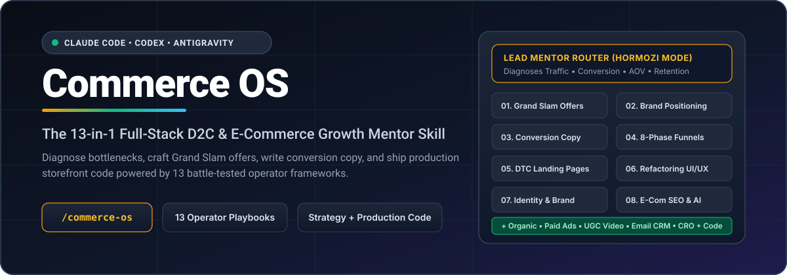
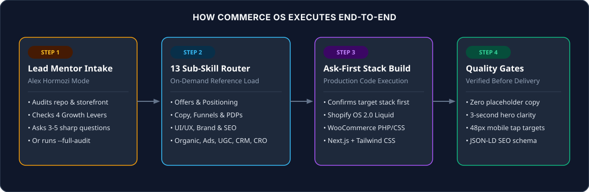

<div align="center">



<br />

[](https://agentskills.io)
[](#quick-install)
[](#the-13-sub-skills--industry-leaders)
[](LICENSE)

**Stop prompting generic AI marketing advice. Turn your coding agent into a full-stack D2C growth partner that diagnoses bottlenecks, engineers Grand Slam offers, writes conversion copy, and ships production storefront code.**

[Quick Install](#quick-install) • [How It Works](#how-it-works) • [The 13 Sub-Skills](#the-13-sub-skills--industry-leaders) • [Example Prompts](#example-prompts) • [Supported Tech Stacks](#supported-tech-stacks)

</div>

## Why Commerce OS?

Most founders and builders stitch together 10 different prompts for offers, copywriting, landing pages, UI/UX, SEO, paid ads, and email flows, and still end up with generic copy and low-converting storefronts.

**Commerce OS (`/commerce-os`)** packages **13 specialized business and engineering sub-skills** into a single, token-efficient skill repository:

- **Starts Like a Real Mentor**: Opens in **Alex Hormozi Lead Mentor Mode**, asking 3 to 5 sharp diagnostic questions across Traffic, Conversion Rate, Average Order Value (AOV), and Lifetime Value (LTV) so you fix your true constraint first.
- **Loads Only What You Need**: Keeps your agent's context window fast and sharp by loading modular playbooks from `references/` on demand (or running a 360-degree review when you pass `--full-audit`).
- **Ask-First Production Code**: Inspects your workspace first, asks which stack you want to target (**Shopify Liquid**, **WordPress/WooCommerce**, **Next.js + Tailwind**, or **HTML/CSS**), and writes production-ready components with zero placeholder text.

## How It Works

<div align="center">
  
</div>

## Quick Install

### Option 1: One-Command Install (Claude Code / Skills CLI)

```bash
npx skills add aiwithjash/commerce-os
```

### Option 2: Clone Directly Into Your Agent Skills Folder

**For Claude Code (`~/.claude/skills/` or project `.claude/skills/`):**

```bash
git clone https://github.com/aiwithjash/commerce-os.git ~/.claude/skills/commerce-os
```

**For OpenAI Codex / Antigravity / Standard `agentskills.io` Workspaces:**

```bash
git clone https://github.com/aiwithjash/commerce-os.git ./skills/commerce-os
```

## The 13 Sub-Skills & Industry Leaders

Every sub-skill in `references/` encodes the step-by-step diagnostic checklists and implementation rules of an industry-leading practitioner:

| # | Sub-Skill Pillar | Industry Leader | Core Framework Encoded | Reference File |
| :--- | :--- | :--- | :--- | :--- |
| **01** | **Lead Mentor & Offer Architecture** *(Face of the Skill)* | **Alex Hormozi** | [$100M Offers Value Equation](https://www.acquisition.com/training/offers4) & Bottleneck Triage | [`01-mentor-and-offers-hormozi.md`](references/01-mentor-and-offers-hormozi.md) |
| **02** | **Brand Positioning & Category Design** | **April Dunford** | [Obviously Awesome 5-Step Positioning](https://www.aprildunford.com/post/a-quickstart-guide-to-positioning) | [`02-positioning-and-copy-dunford-wiebe.md`](references/02-positioning-and-copy-dunford-wiebe.md) |
| **03** | **Conversion Copywriting & Messaging** | **Joanna Wiebe** | [Copyhackers Conversion Copywriting](https://copyhackers.com/conversion-copywriting-defined/) (VoC, PAS, 5 Awareness Stages) | [`02-positioning-and-copy-dunford-wiebe.md`](references/02-positioning-and-copy-dunford-wiebe.md) |
| **04** | **Sales Funnels & Direct-Response Systems** | **Sabri Suby** | [Sell Like Crazy 8-Phase System](https://www.scoreapp.com/sabri-suby-leads-that-scale/) & HVCO Lead Funnels | [`03-funnels-and-web-design-suby-sharma.md`](references/03-funnels-and-web-design-suby-sharma.md) |
| **05** | **E-Commerce Web Design & Landing Pages** | **Nik Sharma** | [Sharma Brands 10-Section DTC Landing Page System](https://www.nik.co/topics/conversion) | [`03-funnels-and-web-design-suby-sharma.md`](references/03-funnels-and-web-design-suby-sharma.md) |
| **06** | **UI/UX & Interface Design Systems** | **Steve Schoger** | [Refactoring UI Tactical Hierarchy & Spacing System](https://www.steveschoger.com/book/) | [`04-ui-ux-and-visual-brand-schoger-do.md`](references/04-ui-ux-and-visual-brand-schoger-do.md) |
| **07** | **Graphic Design & Visual Brand Identity** | **Chris Do** | [The Futur Identity Design & 1-2-3 Focal Point Rules](https://thefutur.com/content/identity-design-branding) | [`04-ui-ux-and-visual-brand-schoger-do.md`](references/04-ui-ux-and-visual-brand-schoger-do.md) |
| **08** | **E-Commerce SEO & Search Architecture** | **Brian Dean** | [Backlinko Commercial SEO & JSON-LD Schema System](https://backlinko.com/seo-tutorial) | [`05-seo-and-organic-growth-dean-vaynerchuk.md`](references/05-seo-and-organic-growth-dean-vaynerchuk.md) |
| **09** | **Organic Social & Content Distribution** | **Gary Vaynerchuk** | [Day Trading Attention PAC Content Waterfall](https://garyvaynerchuk.com/47-pages-that-will-change-your-entire-marketing-organization-approach/) | [`05-seo-and-organic-growth-dean-vaynerchuk.md`](references/05-seo-and-organic-growth-dean-vaynerchuk.md) |
| **10** | **Inorganic / Paid Acquisition & Media Buying** | **Ezra Firestone** | [Smart Paid Traffic 3-Tier Pre-Sell & Promo System](https://smartmarketer.com/smart-paid-traffic/) | [`06-paid-ads-and-ugc-video-firestone-denney.md`](references/06-paid-ads-and-ugc-video-firestone-denney.md) |
| **11** | **Short-Form Video & UGC Ad Scripting** | **Dara Denney** | [Modular Hook-Body-CTA UGC Creative System](https://motionapp.com/event/creative-strategy-workflow-with-dara-denney/) | [`06-paid-ads-and-ugc-video-firestone-denney.md`](references/06-paid-ads-and-ugc-video-firestone-denney.md) |
| **12** | **Email & SMS Lifecycle Retention (CRM)** | **Chase Dimond** | [8 Mandatory E-Commerce Email Automation Flows](https://www.chasedimond.com/flows) | [`07-retention-and-cro-dimond-laja.md`](references/07-retention-and-cro-dimond-laja.md) |
| **13** | **Conversion Rate Optimization (CRO) & Auditing** | **Peep Laja** | [CXL ResearchXL 6-Step Heuristic Audit & PXL Matrix](https://cxl.com/conversion-rate-optimization/how-to-create-a-cro-process-by-peep-laja/) | [`07-retention-and-cro-dimond-laja.md`](references/07-retention-and-cro-dimond-laja.md) |

## Example Prompts

```text
# 1. Start with the Lead Mentor Diagnostic Intake
/commerce-os Diagnose my D2C brand's biggest growth bottleneck and tell me what to fix first.

# 2. Fix Unit Economics with a Grand Slam Offer Stack
/commerce-os My CAC is $48 and my single-item AOV is $42. Build a 3-tier bundle stack, order bump, and risk-reversal guarantee.

# 3. Build & Code a High-Converting Landing Page / PDP
/commerce-os Write Joanna Wiebe conversion copy and code a Nik Sharma 10-section landing page for our hero product.

# 4. Script Modular UGC Ads + Klaviyo Retention Flows
/commerce-os Write 4 Dara Denney UGC ad hooks with 1 modular body and map our 8 Chase Dimond Klaviyo flows.

# 5. Run a Full 13-Pillar Audit & 30-60-90 Day Plan
/commerce-os --full-audit Review our positioning, storefront UI/UX, SEO schema, paid funnel, and CRO leaks.
```

## Supported Tech Stacks

When moving from strategy into code, `commerce-os` inspects your project and asks which stack you want to build in before doubling down via [`08-stack-implementation-guides.md`](references/08-stack-implementation-guides.md):

- **Shopify (OS 2.0 Liquid + Tailwind / Scoped CSS)**: Merchant-editable `` sections, Ajax cart bundle selectors, free-shipping progress bars, and sticky mobile ATC.
- **WordPress + WooCommerce (Elementor / GeneratePress + PHP/CSS)**: Lightweight single-product hooks, checkout friction reducers, in-checkout order bumps, and Rank Math `JSON-LD` schema.
- **Next.js / React + Tailwind CSS**: Accessible headless storefront components built with Steve Schoger's Refactoring UI spacing and color tokens.
- **Standalone Semantic HTML/CSS/JS**: Zero-dependency landing pages and advertorial funnels.

## Repository Structure & Validation

```text
commerce-os/
├── SKILL.md                                                 # Master Lead Mentor orchestrator & router
├── references/
│   ├── 01-mentor-and-offers-hormozi.md                      # Pillar 1: Bottleneck triage & Value Equation
│   ├── 02-positioning-and-copy-dunford-wiebe.md             # Pillars 2-3: Positioning & Copyhackers VoC copy
│   ├── 03-funnels-and-web-design-suby-sharma.md             # Pillars 4-5: 8-phase funnels & DTC landing pages
│   ├── 04-ui-ux-and-visual-brand-schoger-do.md              # Pillars 6-7: Refactoring UI & brand identity
│   ├── 05-seo-and-organic-growth-dean-vaynerchuk.md         # Pillars 8-9: E-commerce SEO & PAC social waterfall
│   ├── 06-paid-ads-and-ugc-video-firestone-denney.md        # Pillars 10-11: Smart Paid Traffic & UGC scripts
│   ├── 07-retention-and-cro-dimond-laja.md                  # Pillars 12-13: Email CRM flows & ResearchXL CRO
│   └── 08-stack-implementation-guides.md                    # Shopify, WooCommerce & Next.js code playbooks
├── assets/
│   ├── banner.svg                                           # Hero header banner
│   ├── workflow-diagram.svg                                 # 4-step execution architecture diagram
│   └── social-preview.png                                   # 1280x640 GitHub Social Preview card
├── tests/
│   └── validate_skill.py                                    # Automated spec, link & formatting validator
└── LICENSE                                                  # MIT License
```

Run the automated validation suite locally at any time:

```bash
python3 tests/validate_skill.py
```

## License

Released under the [MIT License](LICENSE) by [Jash Gelani (@aiwithjash)](https://github.com/aiwithjash). If **Commerce OS** helps you grow or ship faster, please give the repo a star on GitHub!
